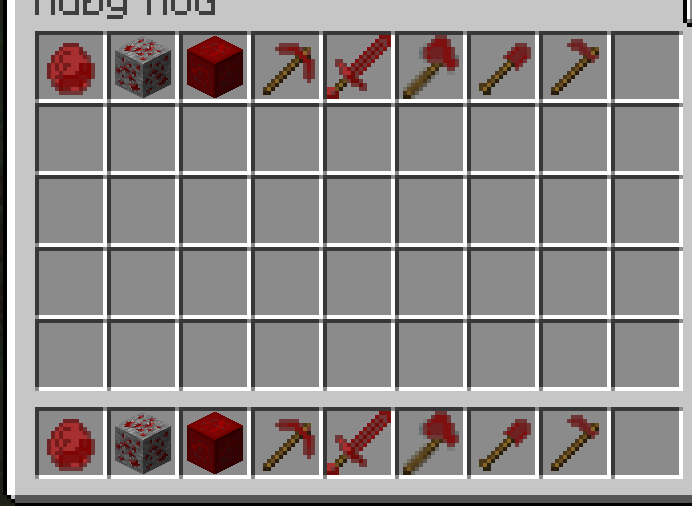
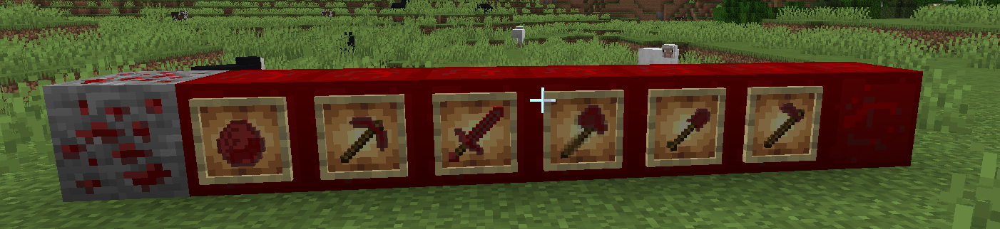

# Ruby Mod




Ruby Mod is a Minecraft mod that adds a new ruby-based material and a complete set of ruby equipment to the game. The goal of this project is to expand the vanilla Minecraft experience with new items, useful tools, and custom textures while keeping everything simple and consistent with the original game's style.

## Features

- **Ruby Ore:** A new ore that drops raw rubies when mined.
- **Ruby Block:** A decorative block crafted using 9 rubies.
- **Ruby Tools:** A complete set of ruby equipment:
  - Ruby Sword
  - Ruby Axe
  - Ruby Shovel
  - Ruby Hoe
- **Custom Textures:** Original 16x16 pixel art textures for the ruby items, ore, and block.
- **Crafting Recipes:** Recipes for crafting all ruby tools and converting between rubies and ruby blocks.
- **Custom Tool Material:** Ruby tools use their own material configuration and custom item statistics.

## Development

Ruby Mod is developed using Java and the Fabric modding environment.

The project includes custom item and block registration, JSON models, blockstates, loot tables, crafting recipes, and English localization.

All textures and assets follow Minecraft's resource structure to ensure that the new content renders correctly in-game.

## Testing

The mod is tested using the Gradle development environment with:

```bash
./gradlew runClient
```

This allows the mod to be launched in a Minecraft development client for testing items, textures, blocks, and crafting recipes.

## Project Status

Ruby Mod is currently under development. More features, improvements, and testing may be added in future updates.

## Credits

Created by **Greg_ios**.

Built as part of the Hack Club Pixlcraft Minecraft Mod trial.
